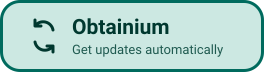

<div align="center">


# Nezzel

**Copy a link. Pick a quality. Save it.**

An Android app with no ads for saving videos, audio and photos from public links.<br>
Available in Arabic, English and French.

<a href="https://github.com/ahmed-abdat/nezzel/releases/latest"></a>
&nbsp;
<a href="https://apps.obtainium.imranr.dev/redirect?r=obtainium://add/https://github.com/ahmed-abdat/nezzel"></a>

[](https://github.com/ahmed-abdat/nezzel/releases/latest)
[](#install)
[](LICENSE)

[Website](https://nezzel.hululsoft.mr) · [العربية](#بالعربية) · [Français](#en-français) · [Tested sites](#tested-sites) · [FAQ](#faq)

<a href="fastlane/metadata/android/en-US/images/phoneScreenshots/1.png"></a>&nbsp;
<a href="fastlane/metadata/android/en-US/images/phoneScreenshots/2.png"></a>&nbsp;
<a href="fastlane/metadata/android/ar/images/phoneScreenshots/2.png"></a>&nbsp;
<a href="fastlane/metadata/android/ar/images/phoneScreenshots/1.png"></a>

<sub>Video in the screenshots: <i>Big Buck Bunny</i> © Blender Foundation, CC BY 3.0.</sub>

</div>

## Why Nezzel

- **No ads, no account, no tracking.** You don't sign up and no analytics run in the background.
- **Real options only.** You only see qualities the site actually offers. Sizes are real, and guesses are marked ≈.
- **Starts from a link.** Share a link to Nezzel, or copy it and open the app. Nezzel offers the link you just copied.
- **Video, audio or photos.** Full HD video, audio only or MP3, every photo in a post, and GIFs that keep their animation.
- **Built for Arabic.** Full right-to-left layout, plus English and French, in light and dark themes.
- **Runs on your phone.** There's no Nezzel server in between: the phone talks to the site directly.

## How it works

1. Copy a link in YouTube, TikTok, Instagram, Facebook, X, or another supported app.
2. Open Nezzel. It offers the link you just copied, or you can share the link straight to Nezzel.
3. Pick a quality and tap **Download**. Files go to `Download/Nezzel`.

<div dir="rtl">

## بالعربية

**Nezzel** تطبيق أندرويد لحفظ الفيديو والصوت والصور من الروابط العامة، بلا إعلانات ولا حساب ولا تتبّع.

انسخ الرابط، وافتح Nezzel، واختر الجودة، ثم اضغط «تنزيل». تُحفظ الملفات في مجلد ‎`Download/Nezzel`‎.

**التثبيت:** حمّل ملف APK من [صفحة الإصدارات](https://github.com/ahmed-abdat/nezzel/releases/latest) أو من [موقع Nezzel](https://nezzel.hululsoft.mr)، ثم افتحه على هاتفك. يخبرك التطبيق عند صدور إصدار جديد، ويُثبَّت الإصدار الجديد فوق القديم دون أن تفقد ملفاتك أو إعداداتك.

</div>

## En français

**Nezzel** est une application Android sans publicité pour enregistrer vidéos, sons et photos depuis des liens publics, sans compte ni pistage.

Copiez un lien, ouvrez Nezzel, choisissez la qualité, puis touchez «&nbsp;Télécharger&nbsp;». Les fichiers vont dans `Download/Nezzel`. Téléchargez l’APK depuis la [page des versions](https://github.com/ahmed-abdat/nezzel/releases/latest) ou le [site de Nezzel](https://nezzel.hululsoft.mr).

## Install

1. Download `nezzel-<version>.apk` from the [latest release](https://github.com/ahmed-abdat/nezzel/releases/latest) or [nezzel.hululsoft.mr](https://nezzel.hululsoft.mr).
2. Open it on your phone. Android asks you to allow installs from your browser or file manager once.
3. That's it. Nezzel tells you when a new version is out and asks before downloading it. You can also follow updates with [Obtainium](https://github.com/ImranR98/Obtainium).

Every release is signed with the same key, so updates install over the old version and keep your files and settings. Site support (yt-dlp) updates itself weekly inside the app.

**Requirements:** Android 10 or newer on a 64-bit ARM phone (`arm64-v8a`).

<details>
<summary><b>Verify the APK</b></summary>

```
Package:   dev.ahmed.savlino
SHA-256:   5C:2F:57:02:02:64:BF:E7:F6:8F:80:3B:DE:BE:77:96:C7:E2:5E:80:EF:AC:91:AB:21:9E:36:96:35:76:94:B7
```

Check with `apksigner verify --print-certs nezzel-<version>.apk`. Each release also lists the APK's SHA-256 in `SHA256SUMS`. The package name `dev.ahmed.savlino` is an old internal name and is intentional.

</details>

## Tested sites

Nezzel uses [yt-dlp](https://github.com/yt-dlp/yt-dlp), so it can open far more sites than this list. These are the ones we checked on a real phone in October 2026. **Saved** means a file was downloaded and saved. **Opens** means the options loaded but saving wasn't tested.

<details>
<summary><b>Video</b>: YouTube, Facebook, Instagram, TikTok, X, LinkedIn, Snapchat, Pinterest and more</summary>

| Site | What we tested | Result |
| --- | --- | --- |
| YouTube | Videos and Shorts, including merged audio/video | Saved |
| Facebook | Public videos and Reels | Saved |
| Instagram | Video posts and Reels | Saved |
| TikTok | Public videos | Saved |
| X / Twitter | Videos and GIF-style videos (saved as video) | Saved |
| LinkedIn | Public video posts | Saved |
| Snapchat | Spotlight videos | Saved |
| Pinterest | Video pins | Saved |
| Bluesky | Video posts | Saved |
| Telegram | Public channel videos | Saved |
| Dailymotion, Vimeo | Public videos | Saved |
| Direct links | MP4 files | Saved |
| Imgur, Odysee, 9GAG, Bilibili, Streamable | Video posts | Opens |
| Twitch, Kick | Clips | Opens |

</details>

<details>
<summary><b>Audio</b>: YouTube Music, SoundCloud, Mixcloud, Bandcamp</summary>

| Site | What we tested | Result |
| --- | --- | --- |
| YouTube / YouTube Music | Audio only (M4A) and MP3 | Saved |
| SoundCloud | Tracks | Opens |
| Mixcloud | Mixes | Opens |
| Bandcamp | Tracks with an MP3 option | Opens |

</details>

<details>
<summary><b>Photos and GIFs</b>: Facebook, Instagram, X, LinkedIn, Bluesky, Telegram</summary>

| Site | What we tested | Result |
| --- | --- | --- |
| Facebook | Public photo posts, including posts with several photos | Saved |
| Instagram | Photos and choosing photos from a carousel | Saved |
| X / Twitter | Photo posts | Saved |
| LinkedIn | Public image posts and animated GIFs | Saved |
| Bluesky | Photo posts | Saved |
| Telegram | Public channel photos | Opens |
| Direct links | JPEG images | Saved |

</details>

**Not supported:** private posts, stories, anything that needs a login, and DRM-protected content. Threads, Reddit, Tumblr and TikTok photo slideshows don't work yet. Sites change often, so a link that worked before can break. See the [FAQ](#faq) to report one.

## FAQ

**Why isn't Nezzel on Google Play?**<br>
Google Play doesn't allow apps that download videos from YouTube. Nezzel is distributed here and on [its website](https://nezzel.hululsoft.mr).

**Android warned me when I installed it. Is that normal?**<br>
Yes. Android shows that warning for any app installed outside Google Play. Allow installs once for the app you opened the APK with. To check that the file is genuine, see [Verify the APK](#install).

**A link doesn't work. What can I do?**<br>
On the error screen, tap **Report this link**. WhatsApp opens with the link filled in, and nothing is sent until you press Send. You can also [open an issue](https://github.com/ahmed-abdat/nezzel/issues/new/choose) with an example that has private details removed. Site support updates itself every week, so try again later too.

**Can it save private videos or stories?**<br>
No. Nezzel never signs in to your accounts, so private, login-only and DRM-protected content stays out of reach.

**Does it work without internet?**<br>
No. It needs a connection to load and download media, but the connection goes straight from your phone to the site, not through a Nezzel server.

## Privacy

There are no analytics, no telemetry and no Nezzel account. Links only go to the site you're saving from, or to WhatsApp when you choose to report one. Nezzel reads the clipboard only while it's open on screen. Details, including every permission and update check: [PRIVACY.md](PRIVACY.md).

## Contributing

Bug reports, site reports and small pull requests are welcome. Build steps, tests and project layout are in [CONTRIBUTING.md](CONTRIBUTING.md). Report security issues privately ([SECURITY.md](SECURITY.md)). Version history is in [CHANGELOG.md](CHANGELOG.md).

## License and responsible use

Copyright (C) 2026 [Hululsoft](https://hululsoft.mr). Nezzel is licensed under **GPL-3.0-or-later** ([LICENSE](LICENSE)). Third-party components keep their own licenses ([THIRD_PARTY_NOTICES.md](THIRD_PARTY_NOTICES.md)). Each release includes the source code for the native components in the APK ([SOURCES.md](SOURCES.md)). The Hululsoft name and logo are not covered by the GPL, and forks must not present themselves as made by Hululsoft.

Download only content you own or have the right to download, and respect the law and each site's terms. Nezzel isn't affiliated with any of the sites it supports, and it doesn't bypass DRM or sign-in requirements.
