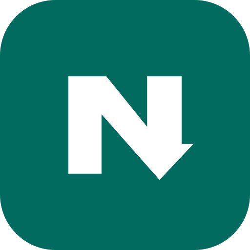
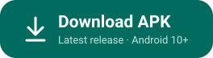
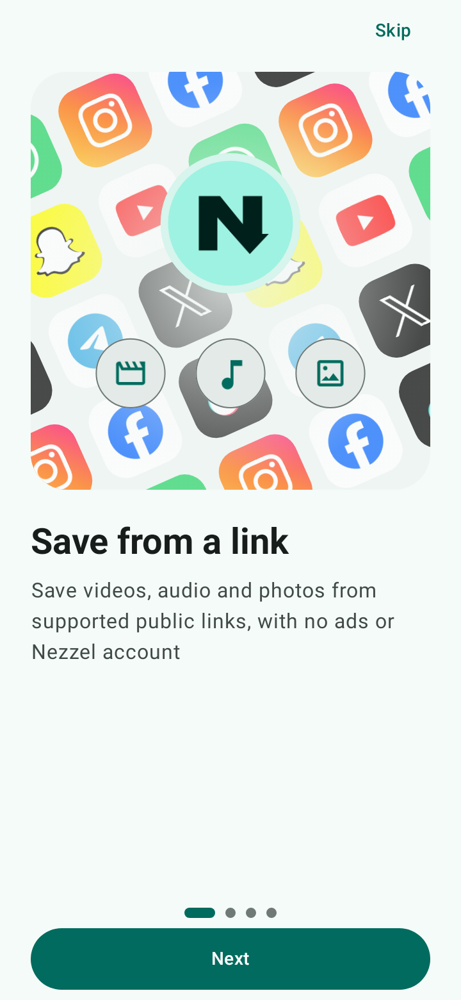
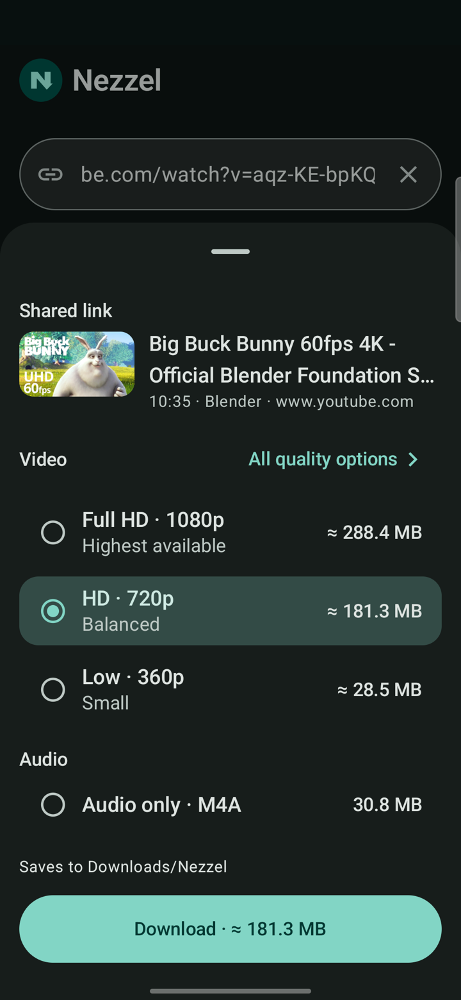
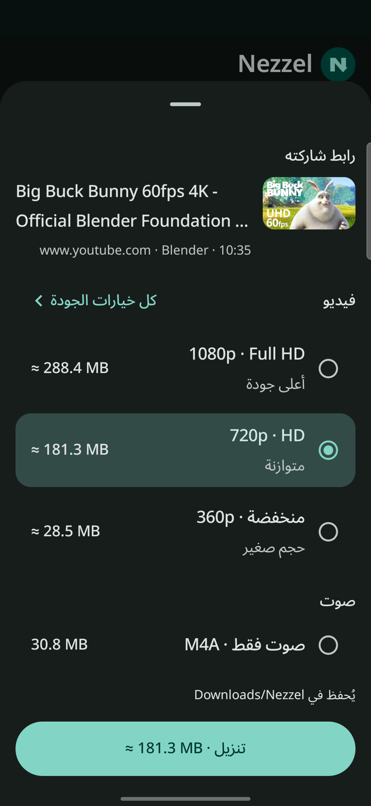
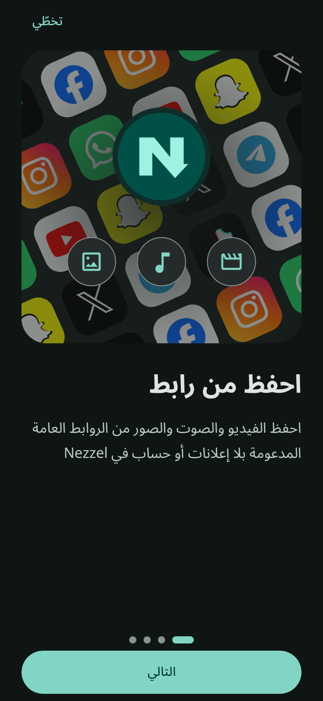

<div align="center">



# Nezzel

**Copy a link. Pick a quality. Save it.**

Save videos, audio and photos from public links on Android.<br>
No ads, no account, no tracking. In Arabic, English and French.

<a href="https://github.com/ahmed-abdat/nezzel/releases/latest"></a>

[](https://github.com/ahmed-abdat/nezzel/releases/latest)
[](#install)
[](LICENSE)

[Website](https://nezzel.hululsoft.mr) · [العربية](#بالعربية) · [Français](#en-français) · [Developers](#for-developers)

<a href="fastlane/metadata/android/en-US/images/phoneScreenshots/1.png"></a>&nbsp;
<a href="fastlane/metadata/android/en-US/images/phoneScreenshots/2.png"></a>&nbsp;
<a href="fastlane/metadata/android/ar/images/phoneScreenshots/2.png"></a>&nbsp;
<a href="fastlane/metadata/android/ar/images/phoneScreenshots/1.png"></a>

<sub>Video in the screenshots: <i>Big Buck Bunny</i> © Blender Foundation, CC BY 3.0.</sub>

</div>

## How it works

1. Copy a link from YouTube, TikTok, Instagram, Facebook, X or another app.
2. Open Nezzel. It offers the link you just copied (or share the link to Nezzel).
3. Pick a quality and tap **Download**. Files go to `Download/Nezzel`.

You only see qualities the site really offers. Sizes are real; estimates are marked ≈.

## Install

1. Download the APK from the [latest release](https://github.com/ahmed-abdat/nezzel/releases/latest) or [the website](https://nezzel.hululsoft.mr).
2. Open it and allow the install once.

Nezzel tells you when a new version is out, and updates keep your files and settings. Needs Android 10+ on a 64-bit ARM phone.

Use [Obtainium](https://github.com/ImranR98/Obtainium)? Add `https://github.com/ahmed-abdat/nezzel` in it.

<details>
<summary>Verify the APK</summary>

Signing certificate SHA-256:

```
5C:2F:57:02:02:64:BF:E7:F6:8F:80:3B:DE:BE:77:96:C7:E2:5E:80:EF:AC:91:AB:21:9E:36:96:35:76:94:B7
```

Check with `apksigner verify --print-certs nezzel-<version>.apk`. Each release also lists file hashes in `SHA256SUMS`.

</details>

## Sites

Tested on a real phone: **YouTube, Facebook, Instagram, TikTok, X, LinkedIn, Snapchat, Pinterest, Bluesky, Telegram, Dailymotion, Vimeo**, plus audio from YouTube Music and photos from Facebook, Instagram, X and Bluesky. Many more sites open thanks to [yt-dlp](https://github.com/yt-dlp/yt-dlp), which updates itself weekly inside the app.

Not supported: private posts, stories, anything behind a login, and DRM-protected content.

A link doesn't work? Tap **Report this link** on the error screen, or [open an issue](https://github.com/ahmed-abdat/nezzel/issues/new/choose).

## FAQ

**Why not on Google Play?** Google Play doesn't allow apps that download from YouTube.

**Android warned me on install.** That's normal for any app installed outside Google Play.

**Is anything sent to a Nezzel server?** No account and no ads. See [PRIVACY.md](PRIVACY.md).

<div dir="rtl">

## بالعربية

تطبيق **Nezzel** لأندرويد يحفظ الفيديو والصوت والصور من الروابط العامة، بلا إعلانات ولا حساب ولا تتبّع.

انسخ الرابط، وافتح Nezzel، واختر الجودة، ثم اضغط «تنزيل». حمّل التطبيق من [صفحة الإصدارات](https://github.com/ahmed-abdat/nezzel/releases/latest) أو من [موقع Nezzel](https://nezzel.hululsoft.mr).

</div>

## En français

**Nezzel** est une application Android sans publicité pour enregistrer vidéos, sons et photos depuis des liens publics, sans compte ni pistage.

Copiez un lien, ouvrez Nezzel, choisissez la qualité, puis touchez «&nbsp;Télécharger&nbsp;». Téléchargez l’APK depuis la [page des versions](https://github.com/ahmed-abdat/nezzel/releases/latest) ou le [site de Nezzel](https://nezzel.hululsoft.mr).

## For developers

Kotlin + Jetpack Compose. Needs JDK 17 and an Android SDK (details in [CONTRIBUTING.md](CONTRIBUTING.md)).

```sh
git clone https://github.com/ahmed-abdat/nezzel.git && cd nezzel
./gradlew :app:assembleDebug --max-workers=2   # APK in app/build/outputs/apk/debug/
sh scripts/test.sh                             # JVM tests
```

| Module | What it does |
| --- | --- |
| `app` | Android UI, downloads, storage, settings |
| `core` | Pure Kotlin domain types, validation and format rules |
| `engine` | yt-dlp bridge, error mapping and public-post readers |
| `site` | The website (`node scripts/site-i18n.mjs` builds `/en/` and `/fr/`) |

Issues and small pull requests are welcome: start with [CONTRIBUTING.md](CONTRIBUTING.md). Security reports go through [SECURITY.md](SECURITY.md). Changes are in [CHANGELOG.md](CHANGELOG.md).

## License

[GPL-3.0-or-later](LICENSE) © 2026 [Hululsoft](https://hululsoft.mr). Third-party licenses: [THIRD_PARTY_NOTICES.md](THIRD_PARTY_NOTICES.md); native sources: [SOURCES.md](SOURCES.md). The Hululsoft name and logo are not covered by the GPL.

Download only what you have the right to download. Nezzel isn't affiliated with any site and doesn't bypass DRM or logins.
